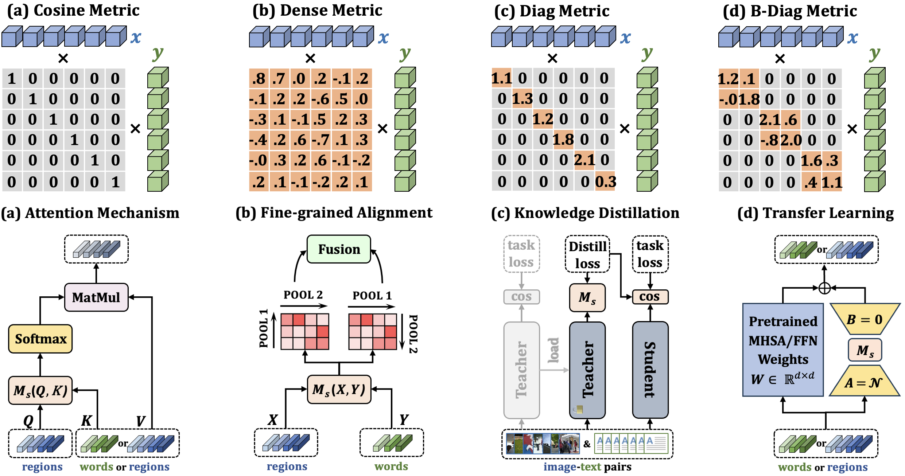

# GSSF

*PyTorch implementation for TIP2024 paper of [**“GSSF: Generalized Structural Sparse Function for Deep Cross-modal Metric Learning”**](https://arxiv.org/abs/2410.15266).*   

*It is built on top of the [SGRAF](https://github.com/Paranioar/SGRAF), [RCAR](https://github.com/Paranioar/RCAR), [DBL](https://github.com/Paranioar/DBL/) and [Awesome_Matching](https://github.com/Paranioar/Awesome_Matching_Pretraining_Transfering).*  

*If any problems, please contact me at r1228240468@gmail.com. (diaohw@mail.dlut.edu.cn is deprecated)*

## Introduction

**The framework of GSSF:**



## Requirements 
Utilize `pip install -r requirements.txt` for the following dependencies.    

*  Python 3.7.11  
*  PyTorch 1.7.1   
*  NumPy 1.21.5 
*  Punkt Sentence Tokenizer:
```python
import nltk
nltk.download()
> d punkt
```

## Download data and vocab
We follow [SCAN](https://github.com/kuanghuei/SCAN) to obtain image features and vocabularies, which can be downloaded by using:

```bash
https://www.kaggle.com/datasets/kuanghueilee/scan-features
```
Another download link is available below：

```bash
https://drive.google.com/drive/u/0/folders/1os1Kr7HeTbh8FajBNegW8rjJf6GIhFqC
```

## Pre-trained models and evaluation
Modify the **model_path**, **split**, **fold5** in the `eval.py` file. 
Note that `fold5=True` is only for evaluation on MSCOCO1K (5 folders average) while `fold5=False` for MSCOCO5K and Flickr30K.   

Then run `python test.py` in the terminal.

## Training new models from scratch
Choose the corresponding `train_xxxx_xxxx.sh` file, and uncomment the required code parts.   

Then run `bash train_xxxx_xxxx.sh` in the terminal.

## Reference

If GSSF is useful for your research, please cite the following paper:  

    @article{Diao2024GSSF,
        author={Diao, Haiwen and Zhang, Ying and Gao, Shang and Zhu, Jiawen and Chen, Long and Lu, Huchuan},
        title={{GSSF:} Generalized Structural Sparse Function for Deep Cross-Modal Metric Learning},
        journal={IEEE Transactions on Image Processing},
        year={2024},
        volume={33},
        pages={6241--6252}
    }

## License

[Apache License 2.0](http://www.apache.org/licenses/LICENSE-2.0).  

